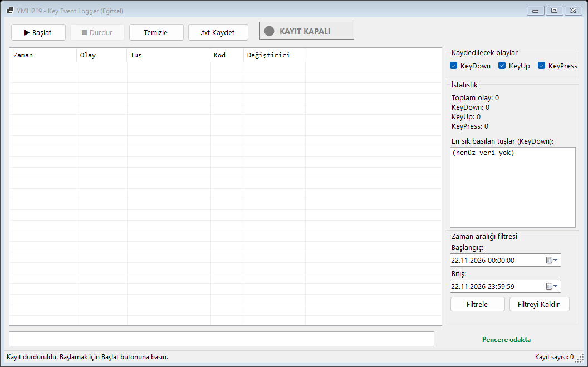
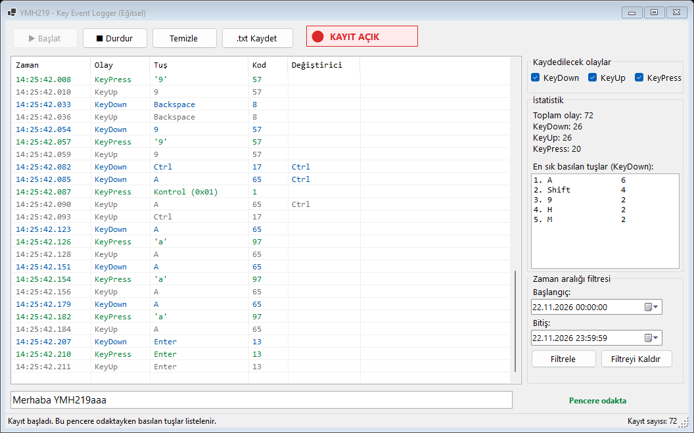
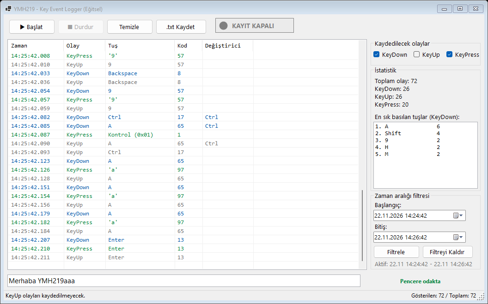

# YMH219 - Key Event Logger (Eğitsel Klavye Olay Kaydedici)

Nesne Tabanlı Programlama (YMH 219) dersi ek uygulama ödevi kapsamında geliştirilmiş, **C# / .NET Windows Forms** ile yazılmış eğitsel bir klavye olay kaydedici.
Uygulama, **yalnızca kendi penceresi odaktayken** basılan tuşların `KeyDown`, `KeyUp` ve `KeyPress` olaylarını yakalar; tuş adını, kodunu, değiştirici tuşları (Ctrl/Shift/Alt) ve milisaniyeli zaman bilgisini listeler. Kayıtlar istenirse yerel bir `.txt` dosyasına kaydedilebilir.

> ⚠️ Bu proje gerçek bir sistem keylogger'ı **değildir**. Global klavye hook'u, gizli/arka plan çalışma, başlangıçta otomatik çalışma, parola yakalama, başka uygulamalardan veri toplama veya ağ üzerinden gönderim **yoktur**.

## Ekran Görüntüleri

| Başlangıç | Kayıt açık | Durduruldu + filtre |
|:---:|:---:|:---:|
|  |  |  |

## Kullanılan Teknolojiler

- C# 14 / .NET 10 (`net10.0-windows`)
- Windows Forms (`KeyPreview`, `KeyDown` / `KeyUp` / `KeyPress` olayları, `ListView`, `StatusStrip`, `SaveFileDialog`)
- Dosya işlemleri: `StreamWriter` (UTF-8)
- LINQ (istatistik ve filtreleme)
- Harici NuGet paketi kullanılmamıştır.

## Kurulum ve Çalıştırma

**Visual Studio ile:**
1. Depoyu klonlayın: `git clone https://github.com/Omerdoganse/YMH219-KeyEventLogger.git`
2. `YMH219-KeyEventLogger.sln` dosyasını Visual Studio 2022 (17.14+) / 2026 ile açın.
3. `F5` ile çalıştırın.

**Komut satırı ile:**
```bash
cd YMH219-KeyEventLogger
dotnet run --project KeyEventLogger
```

> .NET 10 SDK gereklidir: https://dotnet.microsoft.com/download

## Kullanım

| Kontrol | İşlev |
|---|---|
| **▶ Başlat** | Kaydı başlatır (gösterge kırmızı **KAYIT AÇIK** olur) |
| **■ Durdur** | Kaydı durdurur (gösterge gri **KAYIT KAPALI** olur) |
| **Temizle** | Ekrandaki ve bellekteki tüm kayıtları siler |
| **.txt Kaydet** | Görüntülenen kayıtları seçilen `.txt` dosyasına yazar |
| **Kaydedilecek olaylar** | `KeyDown` / `KeyUp` / `KeyPress` olaylarını ayrı ayrı açıp kapatır |
| **Filtrele / Filtreyi Kaldır** | Kayıtları başlangıç–bitiş tarih/saat aralığına göre süzer |
| Alt kısımdaki metin kutusu | Deneme alanı; buraya yazarak olayları gözlemleyebilirsiniz |

## Temel Özellikler

- Pencere aktifken basılan her tuş için **zaman (ms), olay türü, tuş adı, tuş kodu ve değiştirici tuşlar** listelenir; olay türleri farklı renklerle gösterilir.
- **Başlat / Durdur** ile kayıt kontrolü, **Temizle** ile kayıtların silinmesi.
- **Kayıt durumu göstergesi:** kırmızı/gri daireli özel çizimli kontrol (`RecordingIndicator`) + durum çubuğu mesajı.
- **Odak göstergesi:** pencere odağı kaybettiğinde "Pencere odakta değil - kayıt alınmıyor" uyarısı gösterilir.
- **.txt dosyasına kaydetme** (`StreamWriter`); izin yok / klasör yok / dosya kilitli durumlarında anlaşılır hata mesajı.
- **Parola koruması:** odaktaki kutu parola kutusuysa (`UseSystemPasswordChar` / `PasswordChar`) hiçbir olay kaydedilmez.
- Bellek sınırı: en fazla 10.000 kayıt tutulur, sınır aşılınca en eski kayıt silinir.

### İsteğe Bağlı Geliştirmeler (eklendi)

- **İstatistik:** toplam olay sayısı, olay türüne göre sayılar ve **en sık basılan 5 tuş**.
- **Tarih/saat aralığına göre filtreleme** (filtre aktifken istatistik ve kaydetme de filtrelenmiş kayıtlar üzerinden yapılır).
- Hangi olay türlerinin kaydedileceğini seçebilme.

### Örnek `.txt` çıktısı

```
# YMH219 Key Event Logger kayitlari
# Olusturulma: 2026-11-22 14:25:43
# Format: zaman | olay | tus (kod)

2026-11-22 14:25:41.625 | KeyDown  | Shift [Shift] (kod: 16)
2026-11-22 14:25:41.647 | KeyDown  | M [Shift] (kod: 77)
2026-11-22 14:25:41.651 | KeyPress | 'M' (kod: 77)
2026-11-22 14:25:41.654 | KeyUp    | M [Shift] (kod: 77)
2026-11-22 14:25:41.656 | KeyUp    | Shift (kod: 16)
2026-11-22 14:25:41.682 | KeyDown  | E (kod: 69)
2026-11-22 14:25:41.685 | KeyPress | 'e' (kod: 101)
2026-11-22 14:25:41.688 | KeyUp    | E (kod: 69)

# Toplam kayit: 8
```

## Proje Yapısı ve Sınıf Tasarımı

```
KeyEventLogger/
├── Program.cs                 # Giriş noktası, genel hata yakalama
├── LoggerForm.cs              # Ana form: arayüz, klavye olayları, butonlar
├── RecordingIndicator.cs      # Kayıt durumunu çizen özel kontrol
├── Models/
│   ├── KeyEventType.cs        # KeyDown / KeyUp / KeyPress
│   └── KeyLogEntry.cs         # Tek bir olay kaydı (değişmez), kayıt formatı
└── Services/
    ├── KeyEventRecorder.cs    # Kayıt durumu, kayıt listesi, olaylar
    ├── LogFileService.cs      # .txt dosyasına yazma + LogSaveException
    ├── KeyStatistics.cs       # Toplam ve en sık tuş istatistikleri
    └── TimeRangeFilter.cs     # Tarih/saat aralığı filtresi
```

- **Kapsülleme:** `KeyEventRecorder` kayıt listesini `private` tutar, dışarıya yalnızca `IReadOnlyList<KeyLogEntry>` olarak açar; `IsRecording` yalnızca `Start()` / `Stop()` ile değişir. `KeyLogEntry` değişmezdir ve yalnızca fabrika metotlarıyla (`FromKeyEvent`, `FromKeyPress`) oluşturulur.
- **Olaylar (event):** `KeyEventRecorder`, `EntryAdded`, `EntriesCleared` ve `RecordingStateChanged` olaylarını yayınlar; form arayüzü bu olaylarla günceller (kayıt mantığı ile arayüz birbirinden ayrılmıştır).
- **Sorumlulukların ayrılması:** Dosya yazma (`LogFileService`), istatistik (`KeyStatistics`) ve filtreleme (`TimeRangeFilter`) ayrı sınıflardadır; form yalnızca bunları kullanır.
- **Kalıtım:** `RecordingIndicator`, `Control` sınıfından türeyip `OnPaint` metodunu override eder; `LogSaveException`, `Exception` sınıfından türer.
- **Hata kontrolü:** Dosya hataları `LogSaveException` ile anlaşılır mesaja çevrilir; geçersiz filtre aralığında uyarı gösterilir; beklenmeyen hatalar `Application.ThreadException` ile yakalanıp uygulama çökmeden mesaj gösterilir.

## Bilinen Sınırlamalar / Geliştirme Notları

- Olaylar **yalnızca bu pencere odaktayken** yakalanır (bilinçli tasarım; ödevin güvenlik sınırı gereği).
- `Tab` ve ok tuşları bir buton odaktayken Windows Forms tarafından odak gezintisi için kullanıldığından `KeyDown` olayı üretmeyebilir; deneme metin kutusu odaktayken ok tuşları kaydedilir.
- `KeyPress` olayındaki değiştirici bilgisi `Control.ModifierKeys` ile olay anında okunur.
- Kayıtlar yalnızca bellekte tutulur; kalıcı saklama için **.txt Kaydet** kullanılmalıdır.
- Ekran görüntüleri, form olay metotları örnek tuş dizisiyle tetiklenerek oluşturulmuştur.

## Öğrenci Bilgileri

- **Ad Soyad:** Ömer Doğan
- **Öğrenci No:** 250541101
- **Ders:** Nesne Tabanlı Programlama (YMH 219)
